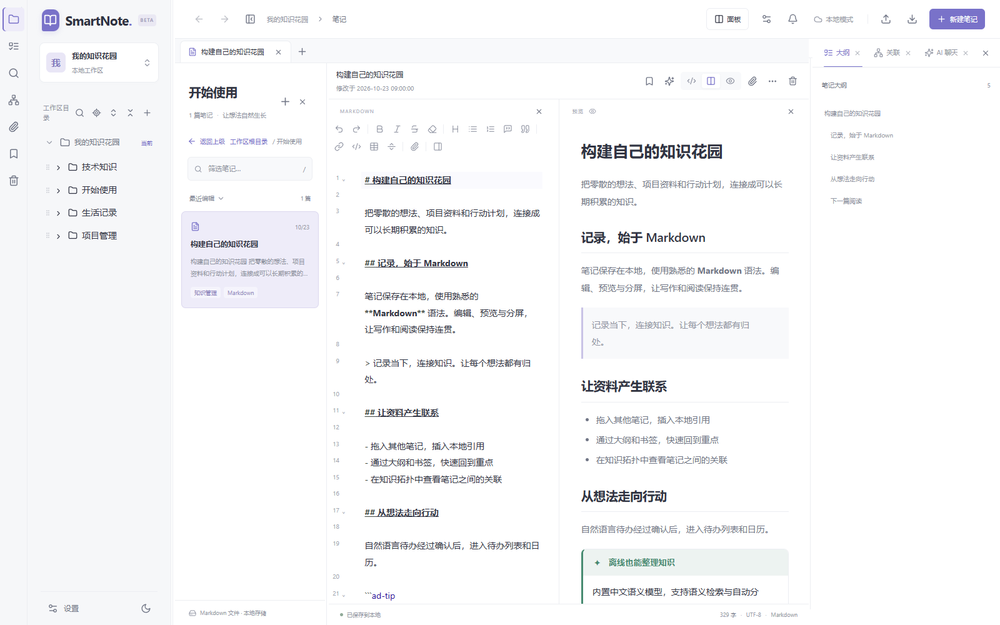
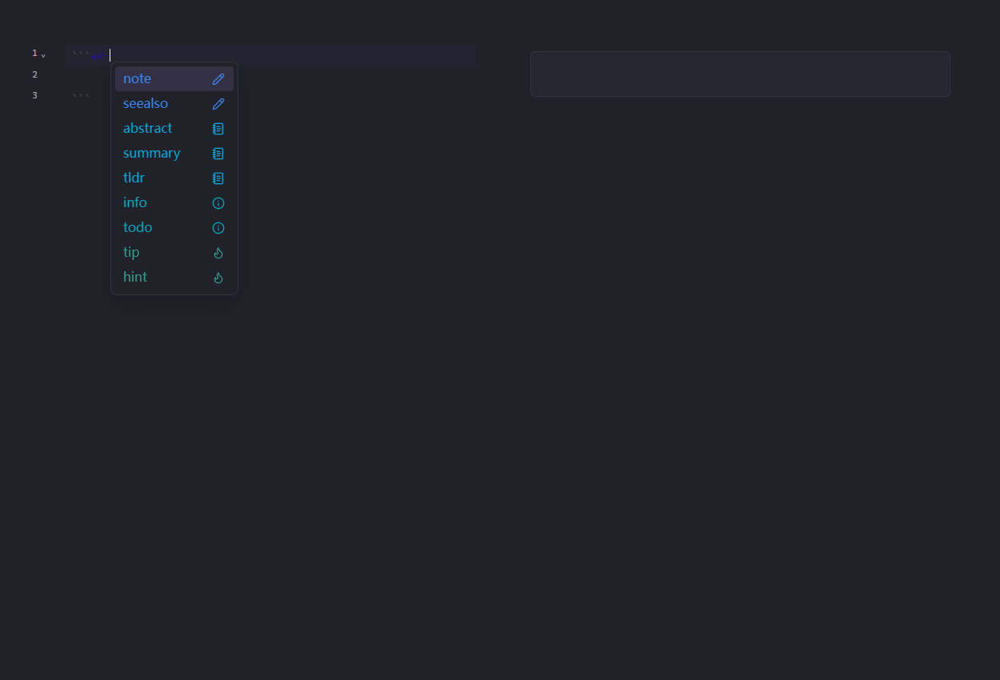
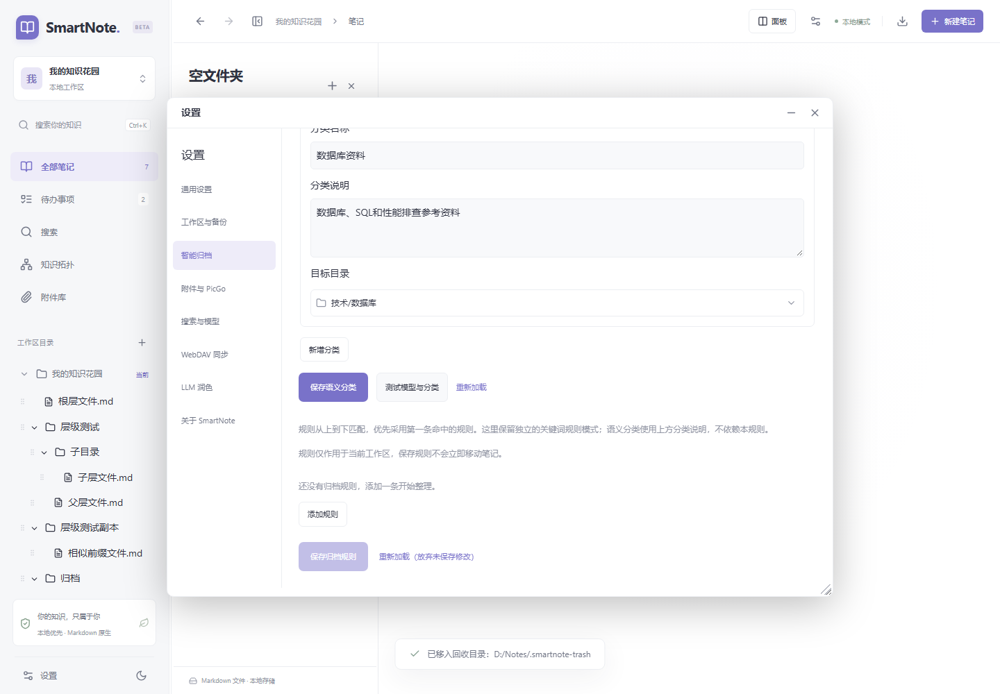
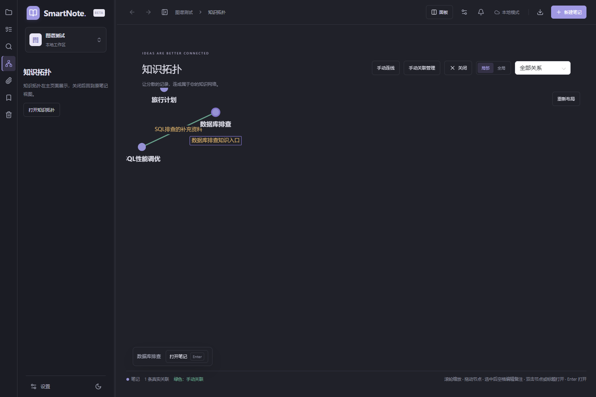
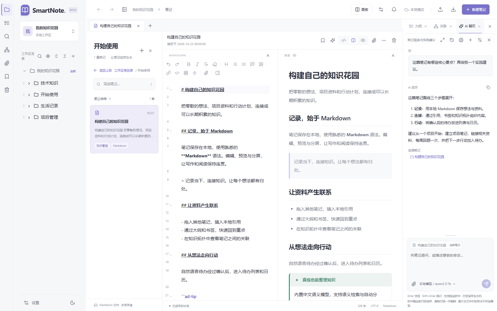
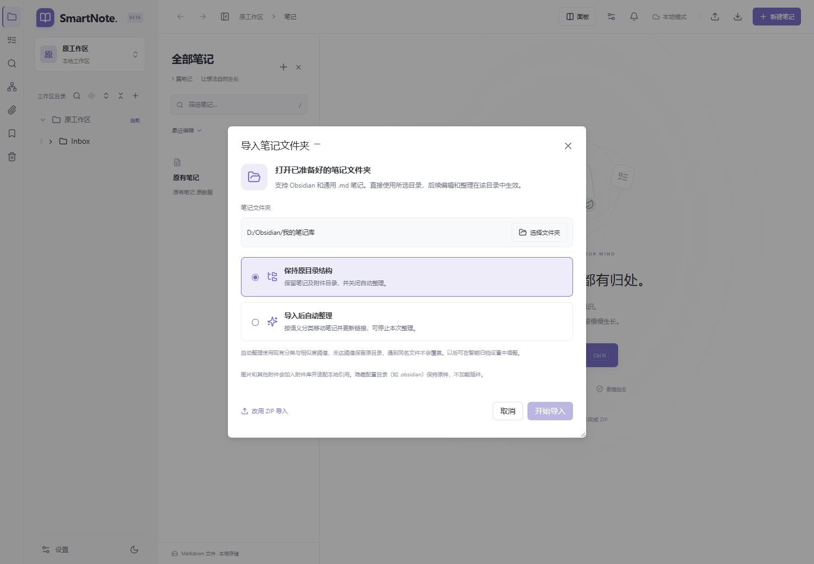

<div align="center">


# SmartNote

**本地 Markdown 笔记 · 离线智能整理 · 个人知识库**

让记录、检索、关联和行动，在同一个工作区里自然衔接。

[](https://github.com/amuer2011/SmartNote/actions/workflows/release.yml)


[下载安装](https://github.com/amuer2011/SmartNote/releases/latest) · [功能特点](#功能特点) · [界面预览](#界面预览) · [开始使用](#开始使用) · [源码构建](#源码构建) · [项目文档](#项目文档)

</div>



## 功能特点

SmartNote 是一款面向个人长期知识积累的桌面笔记应用。笔记以本地 Markdown 文件保存，内置中文语义模型负责检索与分类；需要对话、总结或辅助修改时，再选择连接大模型。

| 特点 | 可以做什么 |
| --- | --- |
| 📝 **本地优先，标准文件** | 编辑、预览、分屏阅读 Markdown；自动保存、草稿恢复、外部修改冲突保护；支持文件夹导入与 Markdown ZIP 导出。 |
| 🧠 **内置离线智能** | 自带 BGE 中文语义模型、分词器与 CPU 运行库，支持长文分块语义检索和自动归档，无需安装 Python、Ollama 或下载模型。 |
| 🗂️ **按自己的方式整理** | 多工作区隔离，文件与文件夹跨目录拖动，复制后粘贴、重命名、自由排序、回收站；分类可新增、编辑、删除。 |
| 📅 **从笔记到行动** | 识别标题与正文中的待办意图，确认后加入待办与日历；支持相对日期、循环任务、截止日期和完成后按年月归档。 |
| 🕸️ **把知识连接起来** | 本地引用、双链解析、前进后退、整篇收藏和位置书签；知识拓扑支持关系、备注、过滤、缩放与笔记跳转。 |
| 💬 **可选 AI 知识助手** | OpenAI 兼容服务或本机 Ollama；多供应商、多模型、思考强度、会话历史和附件；通过工具检索和读取当前工作区，确认差异后修改笔记。 |
| ☁️ **多设备同步** | WebDAV 双向同步或只上传备份；支持笔记、附件与工作区元数据，提供冲突比较和手动合并。 |
| 🎛️ **自由布局与主题** | 浅色 / 深色主题，界面和编辑器独立字体字号，可修改快捷键；左右面板可调整、隐藏、恢复，右侧页签可拖动排序。 |

## 界面预览

以下均为软件实际界面。主界面与 AI 截图使用隔离的演示数据；AI 回复为展示会话，未调用真实服务。其余图片来自功能迭代版本，细节可能与当前版本略有差异。

### 专注写作，也方便阅读

多笔记标签配合编辑、预览和分屏，适应不同工作习惯。普通点击笔记替换当前标签，`Ctrl + 点击`在新标签中打开；再次启动可恢复上次打开的笔记。大纲、关联与 AI 聊天位于右侧，可自由排序、关闭和恢复。

支持常见 Markdown、表格、代码块、任务列表、图片，以及 Obsidian Admonition 风格提示块；输入三个反引号自动补全结束围栏。



### 检索资料，自动找到合适分类

- **导航查询**：按文件名或正文关键词精准匹配，正文命中时显示简短片段。
- **语义检索**：使用内置中文模型理解查询含义，结合关键词与段落结果定位原文。
- **查找与替换**：笔记内和工作区全文均支持正则表达式查找、替换。
- **自动归档**：按最相似分类与可配置的余弦相似度阈值判断；仅有标题也参与分类，编辑后重新计算，未达到条件时保留原位并说明原因。
- **分类管理**：自定义分类名称、说明与目标目录，也可选择已有笔记作为分类样本。



### 待办、循环任务与中国日历

例如“180 天后提醒我充值手机话费”“每月 10 日检查备份”，可识别为待办候选。确认时可调整日期，循环任务可选择截止时间，也可不设截止时间。待办默认展示当日事项，还可查看最近待办与日程概览。

识别待办不会向原笔记自动追加任务正文；重新编辑后会重新计算待办，删除笔记会同步删除对应待办。任务全部完成后，源笔记移入按年、月划分的归档目录；归档笔记再次编辑不会重新生成定时任务。

日历包含农历、节气、中国节假日与调休。当前年和下一年的数据缓存到本地；次年节假日尚未发布时，后续启动静默检查，获取后保存，不重复更新已有完整缓存。


### 知识拓扑，让关联看得见

查看当前工作区的局部或全局关系，点击节点打开原笔记；支持手动关联、节点备注与连线备注。拓扑在主区域展开，关闭后返回笔记，布局、缩放与位置可保存。



### AI 对话，围绕自己的知识库展开

在设置中启用模型服务后，从右侧 **AI 聊天**开始交流，例如“总结当前笔记”“结合工作区资料梳理实施步骤”“把第二节改成检查清单”。助手可以按需检索和读取工作区笔记，展示引用，提出修改建议；确认前可继续对话调整，查看差异后再写回。

支持粘贴长文本、图片和其他附件。过长文本转为文本附件，附件随当前会话保存，删除会话时一并删除。具体可理解的附件类型取决于所选模型和服务能力。



### 迁移现有笔记，保留目录习惯

右上角导入按钮可导入整个 Markdown 文件夹，包括常见 Obsidian 笔记与本地附件；选择保留原目录结构，或导入后自动整理。导入会复制到所选的新工作区目录。

标准 Markdown ZIP 方便跨工具迁移；原生备份用于保留更多 SmartNote 元数据。多设备使用时，可在设置中配置 WebDAV，并在冲突界面比较双方内容。



## 开始使用

**支持 Windows x64、macOS Intel / Apple Silicon，以及 Linux x64 / ARM64。** 平台要求与安装命令见[平台说明](docs/platforms.md)。

从 [GitHub Releases](https://github.com/amuer2011/SmartNote/releases/latest) 下载 `SmartNote-Setup-v1.0.1-windows-x64.exe` 安装包，或 `SmartNote-v1.0.1-windows-x64.exe` 免安装版。macOS 提供 DMG 和 `.app` ZIP，Linux 提供 DEB、RPM、AppImage 和 TAR.GZ，两种架构分别构建。发布包包含离线模型；同页 `SHA256SUMS.txt` 可用于校验下载文件。也可以按下方步骤自行构建。

安装或构建完成后：

1. 运行 `build/bin/SmartNote.exe`，或使用构建生成的安装包安装。
2. 打开一个有读写权限的本地目录作为工作区，也可从右上角导入已有笔记文件夹。
3. 新建笔记，使用可编辑的保存目录下拉框选择目录，或输入 `项目/资料` 这样的相对路径，缺失的子目录会自动创建。
4. 开始编辑，停止输入约 800 ms 后自动保存；新笔记默认进入编辑视图。
5. 使用搜索页签检索资料，按需管理智能分类、待办、书签和知识拓扑。
6. 需要多设备同步或 AI 时，再进入对应设置填写服务信息。

笔记正文保存在所选工作区中；索引、缓存和应用配置保存在应用数据目录。模型首次使用时自动解包并校验。核心编辑、语义检索和分类均可离线运行；WebDAV、远程大模型、图床和节假日首次查询需要对应网络服务。

### 常用快捷键

快捷键可在独立的快捷键设置页修改。macOS 的组合键逻辑使用 `Command` 对应表中的 `Ctrl`；当前发布与验收以 Windows 为准。

| 操作 | 默认快捷键 |
| --- | --- |
| 新建笔记 / 新标签页 | `Ctrl + N` / `Ctrl + T` |
| 保存 / 关闭当前标签 | `Ctrl + S` / `Ctrl + W` |
| 当前笔记查找 / 替换 | `Ctrl + F` / `Ctrl + R` |
| 工作区查找 / 替换 | `Ctrl + Shift + F` / `Ctrl + Shift + R` |
| 快速打开 / 命令面板 | `Ctrl + P` / `Ctrl + Shift + P` |
| 编辑与预览切换 / 分屏 | `Ctrl + E` / `Ctrl + \` |
| 加粗 / 斜体 | `Ctrl + B` / `Ctrl + I` |
| 重命名 / 删除导航项 | `F2` / `Delete` |
| 复制 / 粘贴导航项副本 | `Ctrl + C` / `Ctrl + V` |
| 添加位置书签 | `Ctrl + F2` |
| 导航 / 待办 / 搜索 / 拓扑 | `Ctrl + 1` / `Ctrl + 3` / `Ctrl + 4` / `Ctrl + 5` |
| 附件 / 书签 / 回收站 | `Ctrl + 6` / `Ctrl + 7` / `Ctrl + 8` |
| 编辑器字号 | `Ctrl + 鼠标滚轮` |

焦点在文件导航时，`Ctrl + F` 查询导航栏；焦点在笔记时，查找当前笔记。导航中的复制仅记录来源，粘贴时才生成副本，重名依次使用 `-副本`、`-副本(1)` 等后缀。

## 源码构建

### Windows 环境

- Windows x64、PowerShell。
- Go **1.25.4+**。
- Node.js **22.12+** 与 npm。
- MinGW-w64 GCC，供 CGO / ONNX Runtime 绑定构建使用；确保 `gcc` 在 `PATH` 中可用。
- 运行桌面程序需要 WebView2 Runtime。

```powershell
git clone https://github.com/amuer2011/SmartNote.git
cd SmartNote

# 安装前端依赖、校验内置资源、构建前端、运行 Go 测试并生成 EXE
.\build.ps1

# 已安装依赖后跳过 npm ci
.\build.ps1 -SkipInstall

# 同时生成安装包；脚本会准备 NSIS 编译器
.\build.ps1 -SkipInstall -Installer
```

默认程序输出到 `build/bin/SmartNote.exe`，安装包输出到 `build/bin/`。首次构建需要网络获取 npm / Go 依赖及所需构建工具，终端用户运行核心离线功能无需安装开发工具。

仓库包含内置模型和 Windows CPU 运行库。[资源清单](internal/embedding/assets/manifest.json)固定来源与 SHA-256；`build/Prepare-Embedding.ps1` 校验资源，缺失或不匹配时重新准备。

### macOS / Linux 构建

准备 Go、Node.js 22、Python 3.10+ 及对应系统依赖后，在本机架构执行：

```bash
python3 build/unix.py
```

Linux 还需 GTK 3、WebKitGTK 4.1 开发包及打包工具，完整列表见[平台说明](docs/platforms.md)。构建时下载并校验当前平台运行库，生成的安装包已内置模型与运行库，用户使用时无需下载。

### 开发与检查

```powershell
# 前端开发预览；浏览器不能代替桌面文件接口
npm run dev --prefix frontend

# 类型检查与前端生产构建
npm run build --prefix frontend

# 需先生成 frontend/dist，并准备 CGO 环境
go test ./...
```

浏览器交互检查位于 `frontend/tests/`，多数脚本通过 Playwright 使用隔离数据，并以本机 Chrome 为默认浏览器。运行方式及已验证范围见[验证记录](docs/validation.md)。

### 目录结构

```text
SmartNote/
├── app.go、integrations.go 等   # 桌面接口与应用集成
├── internal/                  # 笔记、索引、模型、任务与同步等后端逻辑
│   └── embedding/assets/      # 内置模型、运行库、许可与校验清单
├── frontend/src/              # Vue 界面、编辑器与状态管理
├── frontend/tests/            # 浏览器交互检查与演示夹具
├── build/                     # 模型准备、图标与 Windows 安装脚本
├── docs/                      # 功能说明、截图、版本与验证记录
└── build.ps1                  # Windows 构建入口
```

技术栈：**Wails 2 · Go · Vue 3 · TypeScript · CodeMirror 6 · SQLite / FTS5 · ONNX Runtime · Cytoscape.js**。农历计算使用 `lunar-go`，节假日数据来自 [Timor API](https://timor.tech/api/holiday/year/2026?type=Y&week=Y)。

## 项目文档

- [当前版本 v1.0.1](docs/release-v1.0.1.md)：macOS Intel / Apple Silicon、Linux x64 / ARM64 原生离线模型与多格式安装包。
- [平台说明](docs/platforms.md)：系统依赖、各发行版安装方式与当前验证范围。
- [Actions 与发布说明](docs/releasing.md)：持续集成、版本标签、构建产物与 Release 发布方式。
- [功能实施状态](docs/implementation-status.md)：已落地能力和后续事项。
- [WebDAV 与大模型配置](docs/sync-and-llm.md)：同步范围、冲突处理、供应商和模型配置。
- [AI 知识助手指南](docs/assistant-knowledge-guide.md)：工作区上下文、工具与交互边界。
- [验证记录](docs/validation.md)：测试方法、构建和验收范围。

当前处于持续迭代阶段。Windows 安装链路及 macOS / Linux 原生构建、离线模型与桌面启动由 CI 验证；自动更新和应用退出后的系统提醒仍待完善。真实 WebDAV / 大模型服务兼容性、万篇笔记规模性能和长期稳定性还需进一步验收。Obsidian 导入覆盖常见 Markdown 与引用方式，不保证第三方插件全部兼容。

## 第三方资源

内置模型使用 **BAAI/bge-small-zh-v1.5** 的 ONNX 量化版本，相关[模型许可](internal/embedding/assets/MODEL-LICENSE)、[ONNX Runtime 许可](internal/embedding/assets/ORT-LICENSE)、[第三方声明](internal/embedding/assets/ORT-ThirdPartyNotices.txt)及运行库许可保存在资源目录。Windows 安装相关许可见 [NSIS](build/windows/NSIS-LICENSE.txt) 和 [第三方声明](build/windows/THIRD-PARTY-NOTICES.txt)。各依赖与资源适用其各自许可。
